# Laboratorio 3 — Sistema de búsqueda de estudiantes: Lista vs ABB vs B+

**Estudiante:** Oscar Alberto Plaza · **Asignatura:** Estructuras de Datos (UdeA) · **Docente:** Edison Alejandro Montoya Gómez

> Este README está escrito como **una guia para entender el laboratorio y como se aplicó la comparación de diferentes estructuras**: cuenta el problema,
> cómo se resolvió, cómo de diseñó el experimento.

---
## 1. Problema y objetivo

Una universidad guarda estudiantes (ID, nombre, edad, promedio) y necesita **buscar por
ID, insertar y listar en orden de ID**. Lo implementé de tres maneras —una **lista de
Python**, un **árbol binario de búsqueda (ABB)** y un **árbol B+**— y medí cómo crece el
tiempo cuando aumenta la cantidad de estudiantes (N) y la cantidad de búsquedas (M).

**Lo que encontré:**

1. La lista crece **en línea recta** con N (exponente medido **1,01**, la teoría dice 1).
   Con 131.072 estudiantes una búsqueda tarda ~2 ms.
2. Los dos árboles crecen **como un logaritmo**: duplicar N solo les suma ~0,1 µs.
   Con 131.072 estudiantes el ABB es **1.000 veces** y el B+ **1.780 veces** más rápido que la lista.
3. Con muy pocos estudiantes (N = 16) **las tres son prácticamente iguales** (~0,3 µs):
   ahí manda el costo fijo de Python, no el algoritmo. La diferencia ya es clara desde N ≈ 64–256.
4. Si los IDs llegan **ordenados**, el ABB **se convierte en una lista**: altura = N,
   exponente medido **1,000** (R² = 1,0000) y hasta 360 veces más lento que el mismo ABB con IDs al azar.
   El B+ ni se entera, porque se balancea solo.
5. El tiempo del ABB es **proporcional a los nodos que recorre** (R² = 0,999): la altura del
   árbol explica el tiempo de búsqueda.

---

## 2. Cómo está organizado el repositorio

```
Lab3/
├── main.py                    ← corre todo: experimentos + tablas + gráficas
├── demo.py                    ← muestra las 3 operaciones en vivo (para la sustentación)
├── sistema_estudiantes/
│   ├── modelo.py              ← qué es un Estudiante y cómo se generan datos y búsquedas
│   ├── estructuras/
│   │   ├── lista.py           ← Estrategia 1: list de Python
│   │   ├── abb.py             ← Estrategia 2: árbol binario de búsqueda
│   │   └── arbol_bmas.py      ← Estrategia 3: árbol B+ (orden 32)
│   ├── config.py              ← TODOS los parámetros del experimento
│   ├── medicion.py            ← cómo se cronometra (perf_counter, gc apagado, ventana ≥ 1 s)
│   ├── experimentos.py        ← experimentos A, B y C
│   ├── estadistica.py         ← media, desviación, CV, IC 95 %, Tukey, ajustes de curvas
│   ├── tablas.py              ← resúmenes .csv y RESUMEN.md
│   └── graficas.py            ← las 12 gráficas
├── pruebas/test_estructuras.py← pruebas de que las 3 estructuras responden bien
├── resultados/
│   ├── entorno.txt            ← hardware, software y parámetros usados
│   ├── datos/                 ← mediciones CRUDAS (una fila por medición)
│   ├── tablas/                ← RESUMEN.md + resúmenes estadísticos .csv
│   └── graficas/              ← 12 figuras .png (ya están; no hay que correr nada para verlas)
└── CODIGO_DE_HONOR.md         ← código de honor y uso de IA
```

La idea de esta organización: **cada archivo tiene un solo trabajo**. Las estructuras no
saben que las están midiendo, la medición no sabe qué estructura mide, y las gráficas se
hacen leyendo los CSV (por eso se pueden regenerar sin repetir el experimento).

## 3. Cómo repetir todo

```bash
pip install -r requirements.txt                 # numpy y matplotlib
python -m unittest discover -s pruebas -v       # 1) verificar que las estructuras funcionan
python demo.py                                  # 2) ver buscar / insertar / listar con 10.000 estudiantes
python main.py --rapido                         # 3) prueba corta (~1 min) en resultados_rapido/
python main.py                                  # 4) experimento completo (~20 min)
python main.py --solo-graficas                  # regenerar tablas y gráficas desde los CSV
```

Recomendaciones: correr en un computador local, con los demás
programas cerrados y sin usar la nube tipo Colab (los recursos compartidos varían).

---

## 4. Las tres estructuras, en palabras sencillas

| | **Lista de Python** | **ABB** | **Árbol B+ (orden 32)** |
|---|---|---|---|
| Buscar | Recorre desde el inicio hasta encontrarlo: **O(N)** | Baja izquierda/derecha comparando: **O(altura)** = O(log N) si es aleatorio, O(N) si degenera | Baja por pocos niveles y busca dentro del nodo: **O(log N)** siempre |
| Insertar | `append` al final: **O(1)** | Baja hasta un hueco: O(altura) | Inserta ordenado en la hoja; si se llena, la parte en dos y sube una clave |
| Listar en orden | Tiene que ordenar (`sorted`): **O(N log N)** | Recorrido in-orden: **O(N)** | Camina por las hojas enlazadas: **O(N)** |
| ¿Se desbalancea? | No aplica | **Sí**, con IDs ordenados | **No**: crece hacia arriba partiendo la raíz |

Detalles de implementación que vale la pena mencionar:

- **Lista:** uso la `list` nativa de Python.
- **ABB:** todo es **iterativo**. Con IDs ordenados el árbol llega a 16.384 niveles y la
  recursión de Python se rompe a los ~1.000. El recorrido in-orden usa una **lista de Python
  como pila**, y la altura se calcula por niveles también con listas.
- **B+:** las claves, los hijos y los registros de cada nodo son **listas de Python
  ordenadas**. Para ubicar una clave dentro del nodo uso búsqueda binaria (`bisect`). Los
  nodos internos solo tienen claves guía; los estudiantes están únicamente en las hojas, y
  las hojas están enlazadas (eso es lo que hace tan rápido el listado y las consultas por
  rango; `demo.py` muestra un ejemplo de rango).
- **Correctitud:** `pruebas/test_estructuras.py` compara las tres contra un diccionario de
  Python con IDs aleatorios y ordenados, varios tamaños y varios órdenes del B+, y revisa
  que todas las hojas del B+ estén al mismo nivel.

---

## 5. Diseño del experimento

| Aspecto | Qué hice y por qué |
|---|---|
| **Hardware** | Intel Xeon @ 2,10 GHz, 2 núcleos, 7,8 GB RAM, Linux (detalle en `resultados/entorno.txt`) |
| **Software** | Python 3.13.16 (CPython), numpy 2.5.3, matplotlib 3.11.2 |
| **Tamaños N (IDs aleatorios)** | 16, 64, 256, 1.024, 4.096, 16.384, 65.536, 131.072. Son potencias de 4: puntos parejos en escala logarítmica y **4 órdenes de magnitud**. Empiezo en 16 para ver la zona donde los costos fijos esconden la diferencia, y termino en 131.072 porque ahí la lista ya tarda ~2 s por lote |
| **Tamaños N (IDs ordenados)** | 16 … 16.384. Construir un ABB degenerado cuesta N²/2 comparaciones: con 16.384 son ~10 s por construcción × 10 repeticiones. Ir más lejos no aporta: la recta ya es perfecta |
| **Búsquedas** | M = 1.000 IDs **existentes** tomados al azar; las tres estructuras reciben **exactamente la misma lista** |
| **Experimento B** | N fijo = 10.000 (el del enunciado) y M = 100, 200, 400 … 25.600 (se duplica) |
| **Experimento C** | N = 65.536 y orden del B+ = 4, 8, 16, 32, 64, 128, 256 (un parámetro extra del problema) |
| **Repeticiones** | **10 por punto**, cada una con **datos nuevos** (semilla distinta). En total 480 mediciones de búsqueda en el experimento A |
| **Generación de datos** | IDs únicos al azar entre 1.000.000 y 9.999.999; nombre, edad (16–30) y promedio (0–5) al azar. En el caso ordenado uso **los mismos IDs** de la misma semilla, solo que ordenados: así lo único que cambia es el orden de llegada |
| **Medición** | `time.perf_counter()`. El lote de M búsquedas se repite hasta acumular **al menos 1 segundo** (regla del profesor: no confiar en mediciones de milisegundos) y se divide por el total de búsquedas. Antes: 50 búsquedas de calentamiento. Durante: recolector de basura apagado. El orden en que se miden las estructuras se baraja en cada repetición |
| **Atípicos** | Regla de Tukey (fuera de Q1 − 1,5·IQR o Q3 + 1,5·IQR). **Se cuentan pero no se borran**: aparecieron 22 de 480 (≈ 5 %, lo esperable con 10 datos por grupo) |
| **Estadísticas** | Media, desviación estándar, coeficiente de variación (CV), mediana, Q1–Q3, mín., máx., intervalo de confianza 95 % (t de Student) y ajustes de curvas: t ≈ a·N^b (log-log) y t ≈ a + b·log2 N |

**¿Son confiables las mediciones?** Sí: el CV de las búsquedas va de 2 % a 15 % (mediana 3,9 %).
Las diferencias entre estructuras son de 2× a 1.000×, muchísimo mayores que ese ruido.

---

## 6. Las gráficas: qué muestran y cómo leerlas

**Convenciones (iguales en todas):** naranja = Lista, azul = ABB, verde = B+.
Línea **continua y punto relleno** = IDs aleatorios; línea **punteada y punto hueco** = IDs
ordenados. Cada punto es la **media de 10 repeticiones** y la barrita vertical es **±1
desviación estándar** (si no se ve, es porque es más pequeña que el punto).

### Gráfica 1 — Búsqueda vs N en escala normal
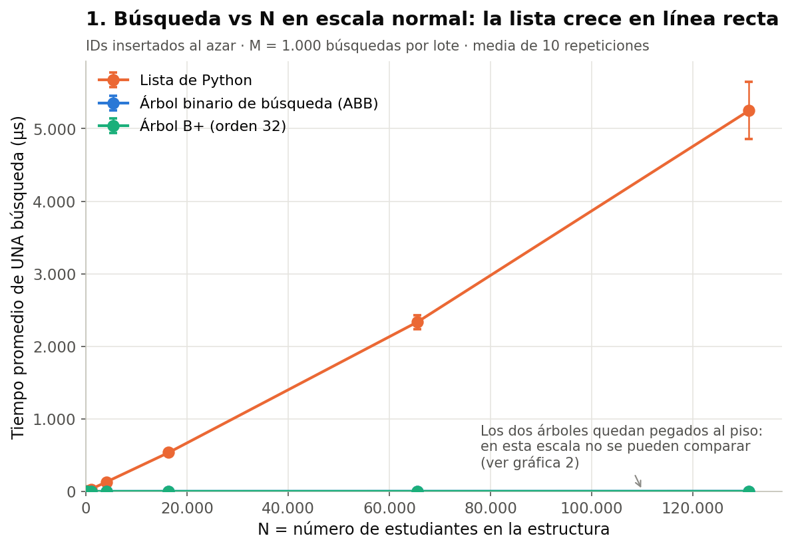

- **Qué muestra:** el tiempo de una búsqueda a medida que crece N, con ejes normales.


### Gráfica 2 — Búsqueda vs N en escala log-log
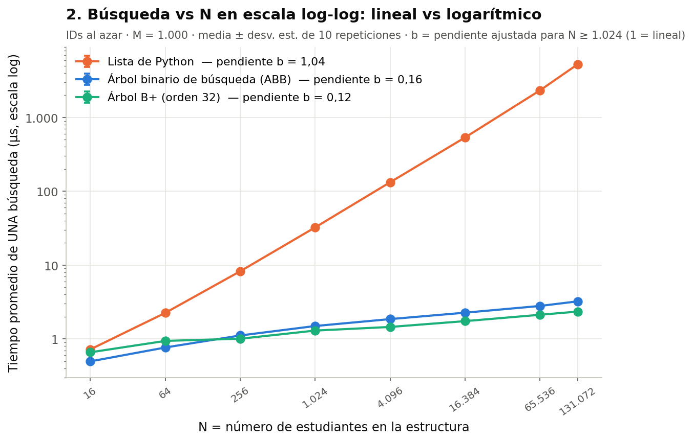

- **Qué muestra:** lo mismo, pero con los dos ejes en escala log.


### Gráfica 3 — Zoom a los árboles con el eje N logarítmico
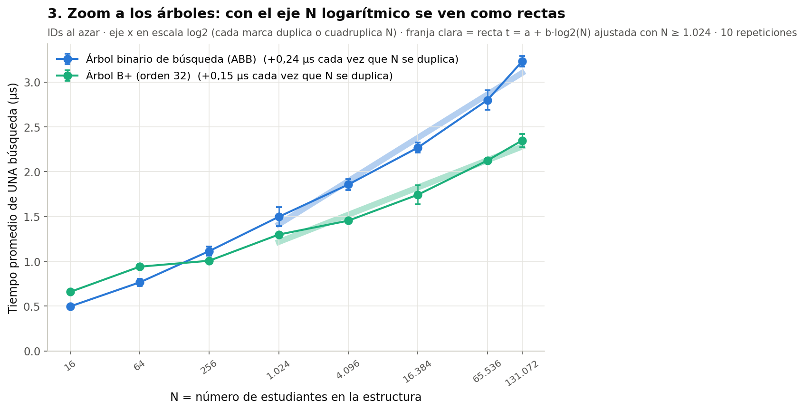

- **Qué muestra:** solo ABB y B+, con N en escala log2 y el tiempo en escala normal.


### Gráfica 4 — IDs aleatorios vs IDs ordenados
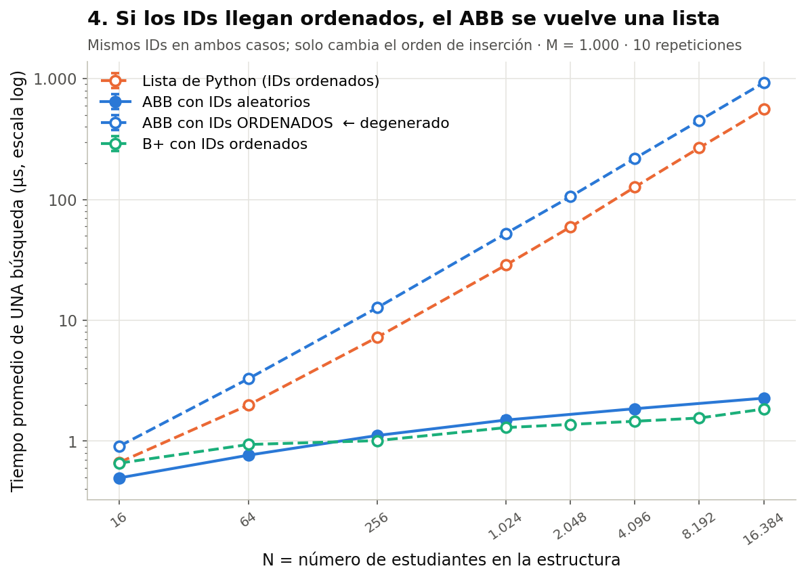

- **Qué muestra:** la misma búsqueda, pero con los estudiantes insertados en orden de ID.


### Gráfica 5 — Altura del árbol vs N
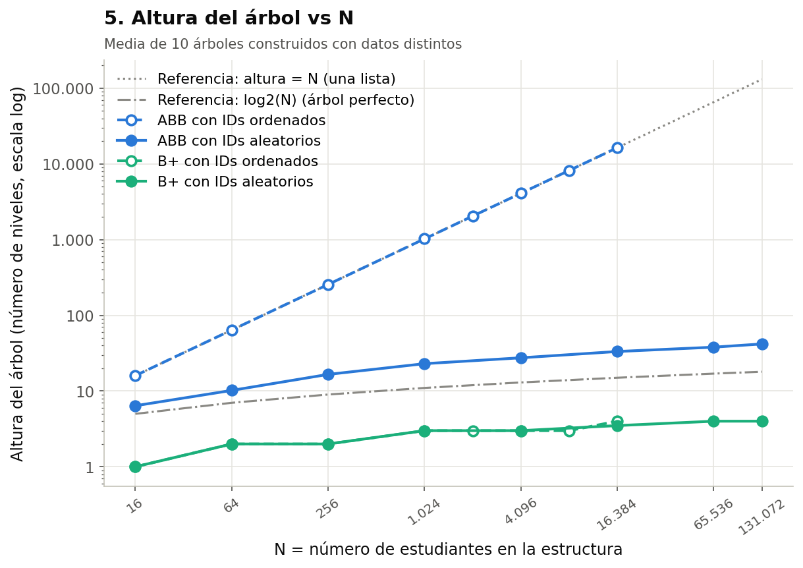

- **Qué muestra:** cuántos niveles tiene cada árbol. Las líneas grises son referencias:
  altura = N (una lista) y log₂N (un árbol binario perfecto).


### Gráfica 6 — ABB: tiempo vs nodos visitados
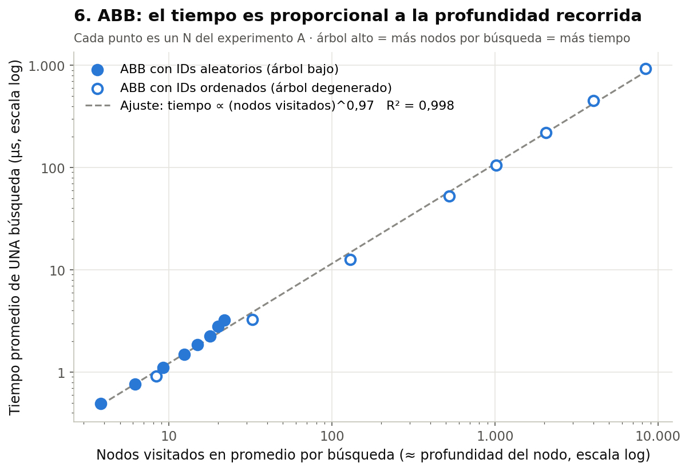

- **Qué muestra:** cada punto es un N; en x el número promedio de nodos que recorre una
  búsqueda, en y el tiempo. Puntos rellenos = árbol bajo (IDs aleatorios); huecos = árbol
  degenerado (IDs ordenados).


### Gráfica 7 — ¿Desde qué N vale la pena un árbol?
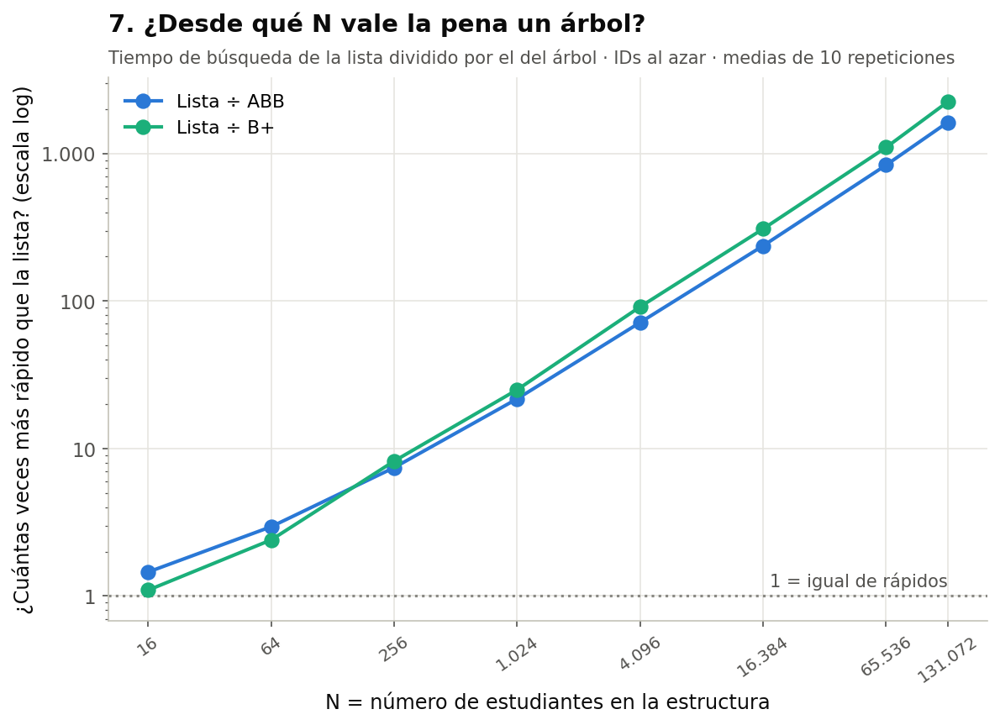

- **Qué muestra:** cuántas veces más rápido es cada árbol que la lista.


### Gráfica 8 — Insertar
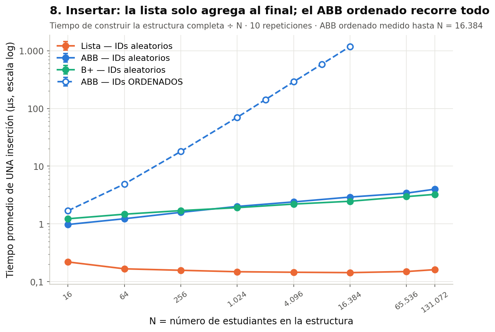

- **Qué muestra:** el tiempo promedio de **una** inserción (construir toda la estructura ÷ N).


### Gráfica 9 — Listar todos en orden de ID
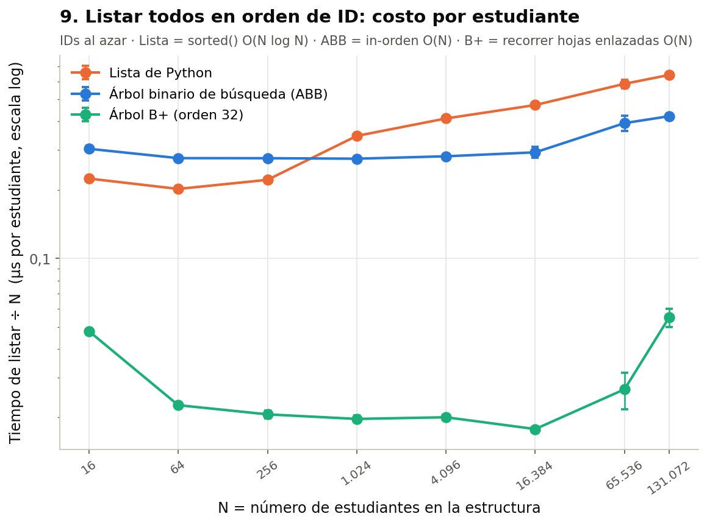

- **Qué muestra:** el tiempo de producir el listado completo, dividido por N (costo por estudiante).


### Gráfica 10 — ¿Qué tan repetibles son las mediciones?
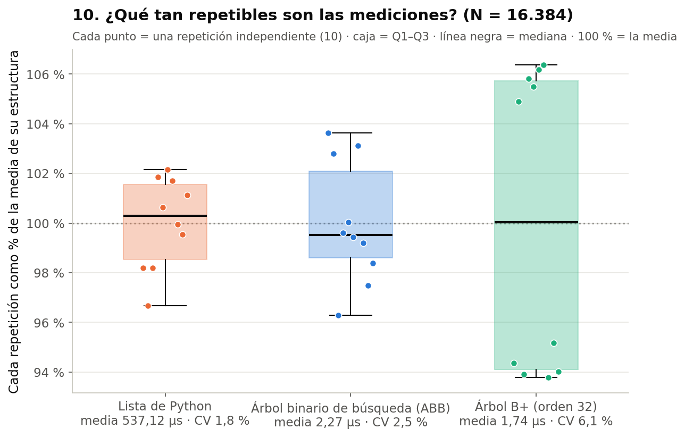

- **Qué muestra:** las 10 repeticiones de N = 16.384, cada una como % de la media de su estructura.


### Gráfica 11 — Tiempo total vs número de búsquedas M
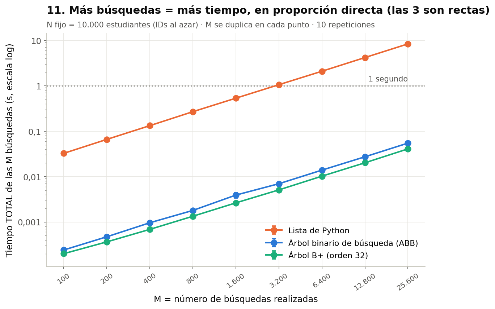

- **Qué muestra:** con N = 10.000 fijo, cuánto tardan **en total** M búsquedas.


### Gráfica 12 — Árbol B+: ¿cuántos hijos por nodo conviene?
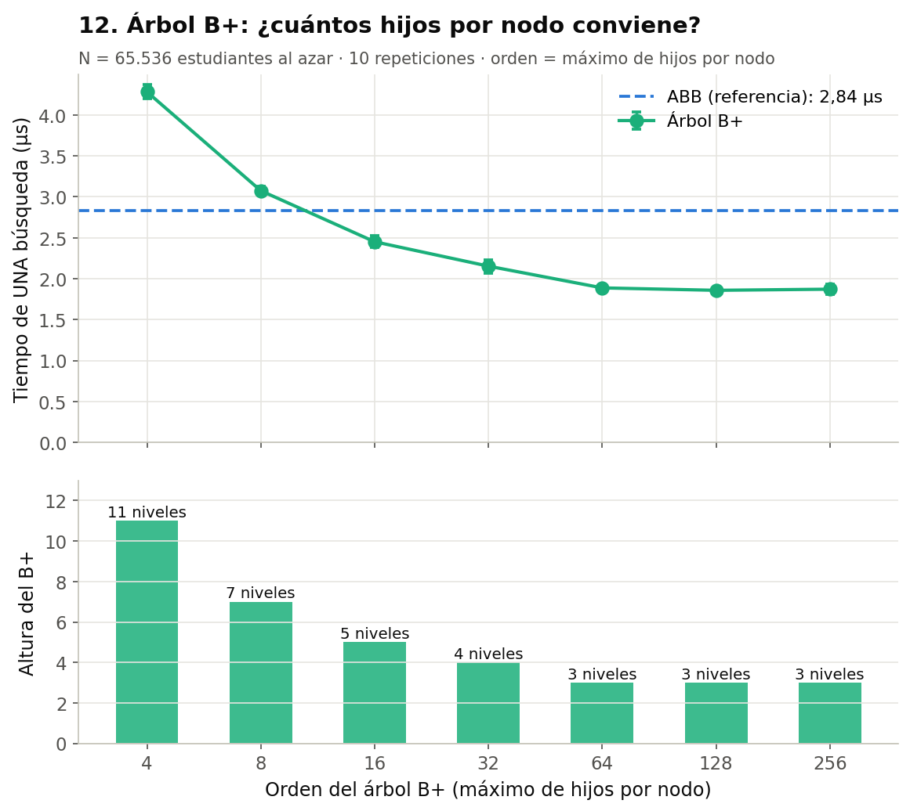

- **Qué muestra:** arriba, el tiempo de búsqueda según el orden del B+; abajo, la altura.


---

## 7. Respuestas a las preguntas del enunciado

**¿Los resultados se comportan como predice la complejidad teórica?**
Sí. La lista tiene exponente medido 1,01 (teoría: O(N)). Los árboles con IDs aleatorios
tienen exponente ≈ 0,15 y se ajustan a una recta contra log₂N (teoría: O(log N)). El ABB con
IDs ordenados tiene exponente 1,000 (teoría: peor caso O(N)). Búsqueda vs M es lineal en las
tres (teoría: M búsquedas cuestan M veces una). La teoría acierta la **forma** de las curvas;
**no** predice las constantes (ej.: ABB degenerado 1,8× más lento que la lista, o B+ de orden 4
más lento que el ABB).

**¿En qué situaciones el árbol binario deja de comportarse como O(log N)?**
Cuando los IDs se insertan ordenados (o casi ordenados, o en orden inverso): cada nuevo nodo
cae siempre al mismo lado, la altura se vuelve N y la búsqueda O(N) (gráficas 4 y 5). Para
evitarlo hace falta un algoritmo de balanceo (AVL, rojo-negro) o usar un B+.

**¿Qué relación existe entre la altura del árbol y el tiempo de búsqueda?**
Directamente proporcional: el tiempo crece como (nodos visitados)^0,96 con R² = 0,999
(gráfica 6). Una búsqueda recorre a lo sumo la altura; en promedio, la profundidad de los nodos.

**¿Qué ocurre cuando los datos se insertan ordenadamente?**
ABB: altura = N, búsqueda e inserción O(N), construir el árbol O(N²) (9,7 s con 16.384).
B+: no cambia el tiempo de búsqueda; lo único que cambia es que las hojas quedan llenas
solo al 51,6 % (con IDs aleatorios ≈ 70 %), porque cada hoja que se parte nunca vuelve a
recibir datos. Lista: la búsqueda no cambia, y el listado se vuelve ~4 veces más rápido
porque `sorted` (Timsort) detecta que los datos ya vienen ordenados.

**¿Qué diferencias aparecen entre los casos aleatorios y ordenados?**
Solo el ABB se afecta (360× más lento con 16.384). La lista y el B+ prácticamente no cambian
en búsqueda.

**¿A partir de qué tamaño de entrada comienzan a ser claramente visibles las diferencias?**
Con N = 16 las tres son casi iguales (diferencia de 1,1–1,3×). Con N = 64 los árboles ya son
2–3× más rápidos y con N = 256 de 5 a 9×. Desde ~1.000 la diferencia es de un orden de
magnitud o más (gráfica 7).

**¿Existen costos constantes que hagan que dos algoritmos con diferente complejidad tengan tiempos similares para entradas pequeñas?**
Sí: con N = 16 una búsqueda en cualquiera de las tres cuesta ~0,3 µs, que es básicamente el
costo de llamar una función en Python. Otros ejemplos de constantes: el ABB degenerado y la
lista son ambos O(N) pero el ABB tarda 1,8× más; el B+ de orden 4 tiene menos niveles que el
ABB y aun así es más lento.

---

## 8. Limitaciones (lo que **no** se puede concluir)

- Todo corre en **memoria RAM**. No medí lecturas de disco, que es donde el B+ realmente
  brilla (el beneficio de tener 3–4 niveles sería mucho mayor).
- **Python** agrega un costo fijo grande por operación; los tiempos absolutos no se pueden
  comparar con C++ o Java. Las **tendencias** sí son generales.
- El ABB **no tiene balanceo**: la conclusión "el ABB se degenera" es para el ABB simple,
  no para un AVL o un rojo-negro.
- Solo busqué IDs **existentes**. Una búsqueda fallida en la lista recorre los N elementos
  (el doble que una exitosa en promedio); en los árboles cuesta lo mismo que una exitosa.
- El caso ordenado llega solo hasta N = 16.384 por el costo de construir el ABB degenerado.
- Las mediciones de las gráficas son de **un solo equipo**. Los valores absolutos cambiarán
  en otro computador; las pendientes y las proporciones deberían mantenerse.

## 9. Conclusiones

1. **Para buscar, la estructura importa más que el computador:** con 131.072 estudiantes
   pasar de lista a árbol hace la búsqueda 1.000 veces más rápida.
2. **La complejidad teórica predice la forma de las curvas, no las constantes.** Por eso
   hay que medir, y medir con N grande.
3. **El ABB es bueno solo si los datos llegan desordenados.** Su tiempo depende de la
   altura, y la altura depende del orden de llegada.
4. **El B+ es el más robusto:** siempre balanceado, la búsqueda más rápida, el listado más
   rápido (hojas enlazadas) y no le importa el orden de los datos. Es la razón por la que lo
   usan los motores de bases de datos.
5. **La lista solo gana insertando** (O(1)) o con muy pocos datos.

## 10. Uso de inteligencia artificial

Ver [`CODIGO_DE_HONOR.md`](CODIGO_DE_HONOR.md).
