# Laboratorio 4 — Puntos de entrega: Quadtree vs fuerza bruta

**Estudiante:** Oscar Alberto Plaza Laverde · **Asignatura:** Estructuras de Datos (UdeA) · **Docente:** Edison Alejandro Montoya Gómez

> Este README es una guía para entender el laboratorio: qué problema se resolvió, cómo se construyó el
> Quadtree a partir de una fuente citada, cómo se verificó que responde bien y cómo se diseñó el
> experimento que compara el árbol contra la fuerza bruta.

---

## 1. Problema y lo que encontré

Un sistema de logística tiene **10.000 puntos de entrega fijos** en una ciudad y debe responder rápido:

* **(a)** ¿qué entregas están a **500 m o menos** de un punto dado? (búsqueda por radio)
* **(b)** ¿cuál es la entrega **más cercana** a una ubicación? (vecino más cercano; también los **k** más cercanos)

Implementé un **Quadtree PR (point-region) por buckets desde cero, para K dimensiones**, y lo comparé con
la **fuerza bruta** (recorrer la lista completa). Todas las coordenadas están en **metros**: el mapa es un
cuadrado de 10.000 × 10.000 m.

**Lo que encontré (en mi computador, Windows 11, Python 3.14.5):**

1. **Cruce (solo consulta):** el Quadtree es más rápido que la fuerza bruta desde **n = 16** en la búsqueda
   por radio y desde **n = 64** en el vecino más cercano. Midiendo con distintas capacidades el cruce se
   movió entre 16–32 (radio) y 32–64 (vecino): es una **zona de cruce**, no un número exacto.
2. **Construcción + consulta:** con una sola consulta el árbol nunca compensa. Con n = 10.000 la
   construcción (147 ms) se paga con **~16 consultas** de radio o **~14** de vecino.
3. Con **n = 10.000** (el caso del enunciado) el árbol es **29×** más rápido en radio y **106×** en vecino;
   con n = 100.000, **38×** y **890×**.
4. **Pendientes en log-log:** fuerza bruta **1,00** (∝ n), construcción **1,10** (≈ n log n),
   vecino en el árbol **0,10** (casi plano, ≈ log n), radio en el árbol **0,75**: con radio fijo los puntos
   que hay que devolver crecen proporcional a n.
5. **Datos agrupados:** el árbol queda **2 niveles más profundo**, pero la búsqueda por radio es más lenta
   sobre todo porque **devuelve ~10 veces más puntos**; por punto devuelto es incluso más barata. El efecto
   real de la profundidad se ve en el vecino: solo **+17 %**.
6. **Capacidad por nodo:** la consulta es más rápida con capacidad **16–32**; la capacidad 64 lleva el cruce
   a n = 128 (hasta 64 puntos el árbol es una sola hoja).
7. El mismo código funciona en **3D (octree, 8 hijos)** y **4D (16 hijos)**, y da exactamente lo mismo que la
   fuerza bruta en todas las pruebas.

---

## 2. Cómo está organizado el repositorio

```
Lab4/
├── Quadtreetree.py        ← EL ÁRBOL: Caja, Nodo, Quadtree + fuerza bruta (fuentes en el docstring)
├── test.py                ← 18 pruebas unitarias + gráficas de verificación 01–03 + análisis de pruebas
├── analisis.py            ← 7 experimentos de rendimiento + tablas + gráficas 04–11
├── config.py              ← TODOS los parámetros (mapa, n, radio, semilla, capacidad, experimentos)
├── datos.py               ← genera puntos uniformes y agrupados (en metros)
├── medicion.py            ← cronómetro (perf_counter, gc apagado, ventana mínima) y estadística
├── mis_dudas.md           ← mi registro de dudas y errores, sesión por sesión
├── resultados/
│   ├── entorno.txt        ← hardware, software y parámetros de la corrida oficial
│   ├── datos/             ← mediciones CRUDAS (.csv, una fila por medición)
│   ├── tablas/            ← RESUMEN.md + resumen.csv (media, desviación, CV, IC 95 %)
│   └── graficas/          ← 11 gráficas .png (ya están: no hay que correr nada para verlas)
├── requirements.txt       ← numpy y matplotlib
├── CODIGO_DE_HONOR.md     ← código de honor y uso de IA
└── README.md
```

Cada archivo tiene un solo trabajo. El árbol no sabe que lo están midiendo, la medición no sabe qué mide, y
las gráficas se hacen **leyendo los CSV** (por eso se pueden regenerar sin repetir el experimento y no
pueden modificar las mediciones).

## 3. Cómo repetir todo (PowerShell, desde la carpeta Lab4)

```powershell
python -m venv .venv
.\.venv\Scripts\Activate.ps1
pip install -r requirements.txt
python Quadtreetree.py               # demostración corta del árbol (vecinos, 200 consultas vs fuerza bruta)
python test.py                       # 1) 18 pruebas + gráficas 01–03            (~35 s)
python analisis.py --rapido          # 2) prueba de humo en resultados_rapido/   (~0,5 min)
python analisis.py                   # 3) experimento oficial                    (~6 min en mi equipo)
python analisis.py --solo-graficas   #    regenerar tablas y gráficas desde los CSV
```

Recomendación: correr el experimento con los demás programas cerrados y el portátil conectado a la corriente.

---

## 4. Fuentes y qué es adaptación mía

El árbol se construyó paso a paso a partir de estas fuentes (citadas también en el docstring de `Quadtreetree.py`):

* [1] Wikipedia, *Quadtree*, secciones "Point-region (PR) quadtree" y "Pseudocode" — <https://en.wikipedia.org/wiki/Quadtree>
* [2] Wikipedia, *K-d tree*, sección "Nearest neighbour search" — <https://en.wikipedia.org/wiki/K-d_tree>
* [3] Wikipedia, *Octree* — <https://en.wikipedia.org/wiki/Octree>
* [4] Wikipedia, *Árbol kd* (versión en español, apoyo para la poda) — <https://es.wikipedia.org/wiki/%C3%81rbol_kd>

| Parte del código | Qué viene de la fuente | Qué adapté yo y por qué |
|---|---|---|
| `Caja(centro, semilado)`, `contiene()` | `AABB` (centro + *halfDimension*) y `containsPoint` de [1] | El centro es una tupla de K números, así sirve en cualquier dimensión |
| `Caja.distancia2_minima()` | — | Mía, inspirada en [2]: "¿la hiperesfera cruza la región?" = ¿la distancia mínima a la caja es ≤ radio? |
| `Nodo`: capacidad, puntos, hijos, `subdividir()` | `QT_NODE_CAPACITY` y `subdivide` de [1]; 8 hijos en 3D de [3] | **2^K hijos** guardados en un diccionario cuya clave son K valores True/False (un bit por dimensión). Ninguna fuente lo generaliza a K |
| `insertar()` | `insert` de [1] | (1) al subdividir **reparto** los puntos: solo las hojas guardan (en [1] el nodo se queda con los suyos); (2) elijo el hijo comparando con el centro, sin probar los 4; (3) un punto **fuera del mapa lanza `ValueError`** en vez de ignorarse; (4) `PROFUNDIDAD_MAXIMA = 20` contra la recursión infinita con duplicados |
| `buscar_radio()` | `queryRange` de [1] | El enunciado pide un **radio**, así que el rango es un **círculo**: "¿toca la caja?" se responde con `distancia2_minima` |
| `buscar_vecinos()`, `k_vecinos()` | Vecino más cercano y extensión a k vecinos de [2] | Aplicado a las cajas del quadtree; visito primero el hijo más cercano; lista ordenada de los k mejores |
| Distancias al cuadrado | [2] | Se compara d² ≤ r²; la raíz solo se saca al final para devolver metros |
| Funciones de fuerza bruta | Pedidas por el enunciado | Referencia contra la que se verifica todo |

---

## 5. Decisiones de diseño

| Decisión | Por qué |
|---|---|
| **Metros** en todo (mapa de 10.000 × 10.000 m, radio 500 m) | Coordenadas, distancias y radio en la misma unidad; el enunciado pide cuidar las unidades |
| Caja con **centro + semilado** | Es la forma del `AABB` de la fuente; la mitad de un hijo es simplemente `semilado / 2` |
| **Capacidad 4** por defecto | Es el `QT_NODE_CAPACITY` del pseudocódigo de [1]. La medí de 1 a 64 (sección 10): 16 sería ~28 % más rápida en radio |
| **Profundidad máxima 20** | Con puntos idénticos, dividir nunca los separa y la recursión no termina (lo comprobé: `RecursionError`). En el nivel 20 la caja mide 10.000 / 2²⁰ ≈ 1 cm |
| **Punto fuera del mapa → error** | Si se guardara en una caja que no lo contiene, la poda descartaría esa caja y la búsqueda nunca lo encontraría |
| **K dimensiones** con `product` y `zip` | En ninguna línea del árbol aparece el número 2: K se deduce del centro. 2D = quadtree, 3D = octree, K = 2^K hijos |
| **Semilla fija 4** ("Lab 4") | Los mismos datos en cada ejecución: pruebas y gráficas reproducibles |
| **Distancias al cuadrado** | La raíz cuadrada es cara y no hace falta para comparar (si d ≤ r entonces d² ≤ r²) |

## 6. Los algoritmos, en palabras sencillas

| Operación | Quadtree | Fuerza bruta |
|---|---|---|
| **Insertar / construir** | El punto baja por la caja que le corresponde hasta una hoja; si la hoja pasa de la capacidad, se divide en 2^K y reparte. Construir = n inserciones ≈ **n · profundidad** | No hay construcción: los puntos ya están en una lista |
| **Radio** | Desde la raíz: si la distancia mínima a la caja es mayor que el radio, **se descarta la caja con todo lo que contiene**; si es hoja, se mide cada punto; si no, se baja a los hijos | Mide la distancia a los **n** puntos |
| **k vecinos** | Lista de los k mejores; se visita primero el hijo más cercano; una caja se descarta cuando ya hay k candidatos y la caja está más lejos que el k‑ésimo | Mide los n puntos, ordena y toma los k primeros |

La **poda** (descartar cajas enteras) es lo único que hace más rápido al árbol. Visitar primero el hijo más
cercano no cambia el resultado pero sí el trabajo: medí **31 nodos visitados por consulta** ordenando los
hijos contra **593** sin ordenarlos.

---

## 7. Pruebas (`python test.py`)

Cada búsqueda del árbol se compara con la fuerza bruta: el resultado debe ser **exactamente igual**
(mismos puntos y mismas distancias). Resultado: **`Ran 18 tests ... OK`**.

| # | Prueba | Qué verifica |
|---|---|---|
| 01 | Ningún punto se pierde ni se duplica | Las hojas guardan exactamente los 10.000 puntos |
| 02 | **El árbol realmente se divide** | Raíz con hijos, profundidad > 3, nodos internos vacíos con 4 hijos. Detecta un árbol que nunca se divide: daría resultados correctos ¡pero sería fuerza bruta! |
| 03 | Capacidad y caja | Ninguna hoja pasa de la capacidad y cada punto está dentro de la caja de su hoja |
| 04 | Bordes del mapa | Esquinas, bordes y la línea del centro se guardan y se encuentran |
| 05 | Radio 500 m = fuerza bruta | 300 consultas, datos uniformes **y agrupados** |
| 06 | Varios radios = fuerza bruta | 10, 100, 1.000 y 3.000 m |
| 07 | Vecino más cercano = fuerza bruta | 300 consultas, uniformes y agrupados |
| 08 | k vecinos = fuerza bruta | k = 1, 3, 10 y 50 |
| 09 | Capacidades | 1, 4, 16 y 64 dan el mismo resultado |
| 10 | Punto exactamente a 500 m | Entra (≤); el que está a 500,001 m no |
| 11 | Radio 0 y radio gigante | Radio 0 devuelve solo el punto idéntico; radio de 20 km devuelve todos |
| 12 | Consulta fuera del mapa | Radio, vecino y k vecinos siguen correctos |
| 13 | k > n y k = 0 | Devuelve los n que hay / lista vacía |
| 14 | Árbol vacío | `None`, listas vacías, profundidad 0 |
| 15 | 50 puntos duplicados | Se guardan sin recursión infinita; el árbol se detiene en la profundidad 20 |
| 16 | Punto fuera del mapa | Se rechaza con `ValueError` y no cambia el árbol |
| 17 | **3D (octree)** | 8 hijos; radio, vecino y k vecinos = fuerza bruta en 200 consultas |
| 18 | **4D** | 16 hijos; k vecinos = fuerza bruta |

Además, `test.py` comprueba que **graficar no modifica los datos**: copia la lista de puntos antes de
graficar y al final exige que siga idéntica y que el árbol devuelva lo mismo.

## 8. Verificación visual

### Gráfica 1 — Estructura del árbol: uniforme vs agrupado
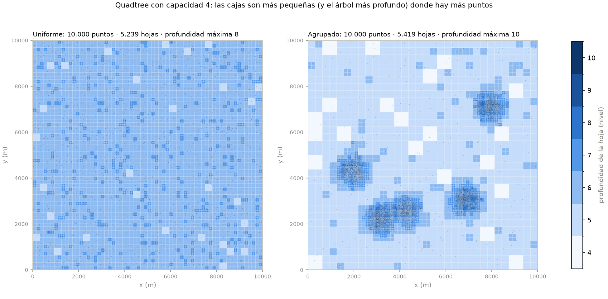

Cada rectángulo es una **hoja**, coloreada por su profundidad (claro = caja grande, oscuro = caja pequeña).
Con datos uniformes casi todas las hojas quedan en los niveles 6–7 (profundidad máxima **8**, 5.239 hojas);
con datos agrupados el árbol baja hasta el nivel **10** en los núcleos y deja cajas grandes en las zonas
vacías (5.419 hojas). Esta gráfica habla de **estructura**, no de tiempo.

### Gráfica 2 — Búsqueda por radio y poda
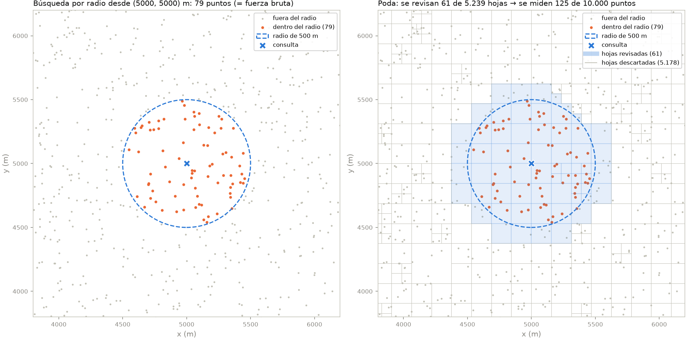

Izquierda: los **79 puntos** a 500 m o menos de (5000, 5000), idénticos a la fuerza bruta (se esperaban
~78,5 = 0,785 % de 10.000). Derecha: solo se revisan **61 de 5.239 hojas**, es decir se mide la distancia a
**125 de 10.000 puntos (1,2 %)**. Se revisan más puntos de los que entran porque las hojas que tocan el borde
del círculo están en parte afuera. Esto **no** significa que el árbol sea 80 veces más rápido: recorrer nodos
también cuesta (ver sección 10).

### Gráfica 3 — Vecino más cercano y 5 vecinos
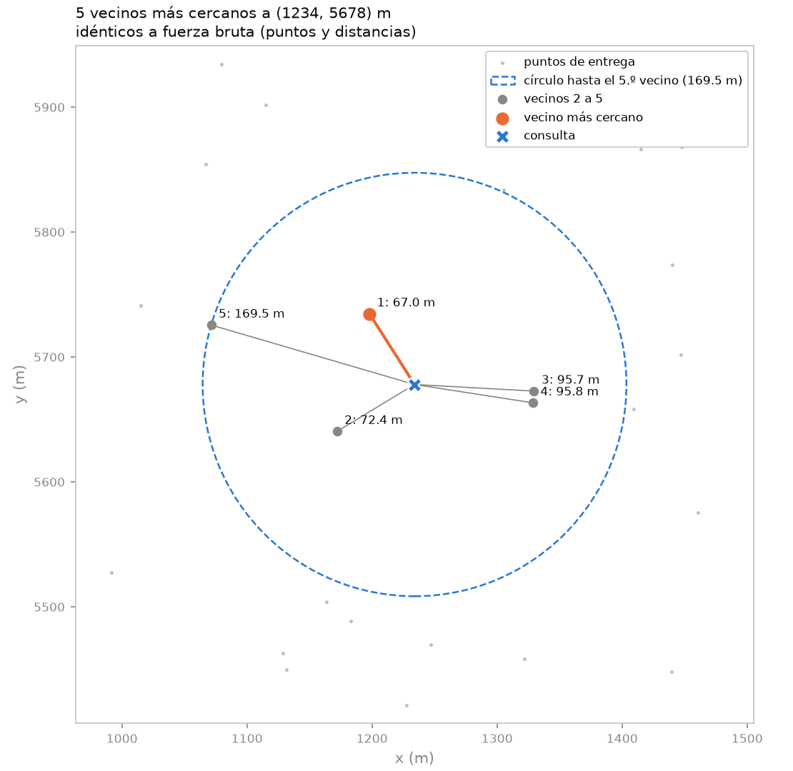

Desde (1234, 5678) el más cercano está a **67,04 m**; el círculo pasa por el 5.º vecino (169,47 m) y dentro de
él no hay ningún otro punto. Puntos y distancias son idénticos a la fuerza bruta (lo verifica un `assert`
antes de dibujar). Son k vecinos **reales**: no salen de una búsqueda por radio.

---

## 9. Diseño del experimento (`python analisis.py`)

| Aspecto | Qué hice y por qué |
|---|---|
| **Equipo** | Windows 11, Python 3.14.5 (CPython), numpy 2.5.4, matplotlib 3.11.2. Procesador y detalle en `resultados/entorno.txt`. Duración de la corrida oficial: 5,9 min |
| **Dos rangos de n** | **Pequeño** (1, 2, 4 … 1.024, potencias de 2) para ubicar el cruce; **grande** (10³ a 10⁵) para tendencias limpias y pendientes. 
| **Consultas** | Hasta 200 puntos de consulta al azar por bloque; con n grande se usan max(10, 400.000 / n) para que la fuerza bruta no tarde horas. Árbol y fuerza bruta reciben **exactamente las mismas consultas** |
| **Medición** | `time.perf_counter()`; el bloque de consultas se repite hasta acumular una **ventana mínima** (0,1 s en el rango pequeño, 0,2 s en el resto) y se divide por el total de consultas. Recolector de basura **apagado**. Calentamiento previo. El **orden** en que se miden los métodos se baraja en cada repetición |
| **Repeticiones** | **5 por punto**, cada una con **datos nuevos** (semilla distinta). Se reporta media ± 1 desviación estándar, CV e IC 95 % (t de Student) en `resultados/tablas/resumen.csv` |
| **Experimentos** | A: cruce · B: tendencia y amortización · C: capacidad 1–64 (y cruce con 1, 4, 16, 64) · D: uniforme vs agrupado · E: radio 25–5.000 m con n = 10.000 · F: 3D |
| **Datos agrupados** | 80 % alrededor de 5 núcleos (desviación de 300 m) y 20 % de fondo uniforme. Las consultas siguen la **misma distribución** que los datos (los clientes están donde vive la gente) |
| **Ajustes** | t ≈ a·nᵇ con una recta en log-log; la pendiente b dice cómo crece el tiempo y R² qué tan bien se ajusta |

**¿Son confiables las mediciones?** El CV de los tiempos de consulta tiene mediana **2,3 %** (máximo 40,6 %,
en grupos de n pequeño). Las diferencias entre árbol y fuerza bruta en el rango grande son de 10× a 900×,
muchísimo mayores que ese ruido. Cerca del cruce, en cambio, las diferencias son de 10–20 %: por eso hablo
de zona de cruce.

---

## 10. Resultados: las gráficas y cómo leerlas

**Convenciones:** azul = Quadtree, naranja = fuerza bruta. Cada punto es la **media de 5 repeticiones** y la
barrita es **±1 desviación estándar** (si no se ve, es más pequeña que el punto). Cuando un eje es
logarítmico lo dice el título; lo uso cuando los valores abarcan varios órdenes de magnitud: en log-log una
potencia nᵇ se ve como una recta de pendiente b.

### Gráfica 4 — Construcción vs n
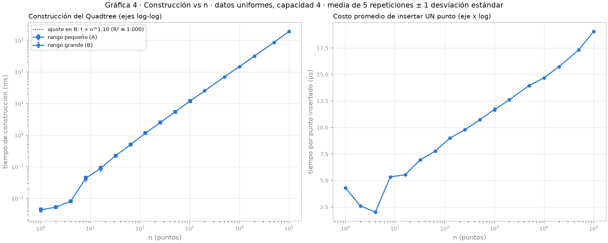

Construir cuesta n inserciones y cada una baja ≈ log n niveles. Pendiente medida **1,10** (R² = 1,0000); una
curva n·log n entre 10³ y 10⁵ tiene pendiente aparente ≈ 1,11. A la derecha, insertar **un** punto pasa de
~12 µs a ~19 µs cuando n crece 100 veces (la profundidad pasa de 6 a 10). **Construir es caro, buscar no**:
son dos cosas distintas.

### Gráfica 5 — Tiempo por consulta vs n, con el cruce
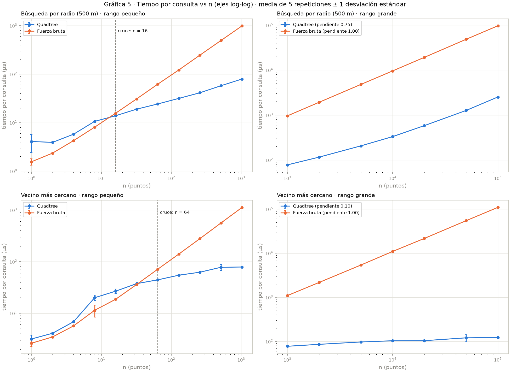

* **Fuerza bruta: pendiente 1,00** en las dos búsquedas: duplicar n duplica el tiempo **por consulta**.
  (El tiempo total de n consultas sería n², pendiente 2.)
* **Vecino en el árbol: 0,10** — de 77 µs a 123 µs mientras n crece 100 veces.
* **Radio en el árbol: 0,75** — con radio fijo los puntos devueltos crecen ∝ n (de 7,6 a 757 por consulta);
  entre 50.000 y 100.000 la pendiente local ya es ~1: devolver resultados domina.
* Con **n ≤ 4** el árbol siempre pierde: con capacidad 4 es una sola hoja, es decir fuerza bruta más el costo
  de entrar al árbol. El **vecino cruza después** que el radio porque en cada nodo ordena los hijos, un
  costo fijo que solo se compensa desde n ≈ 64.

### Gráfica 6 — La misma información en escala lineal
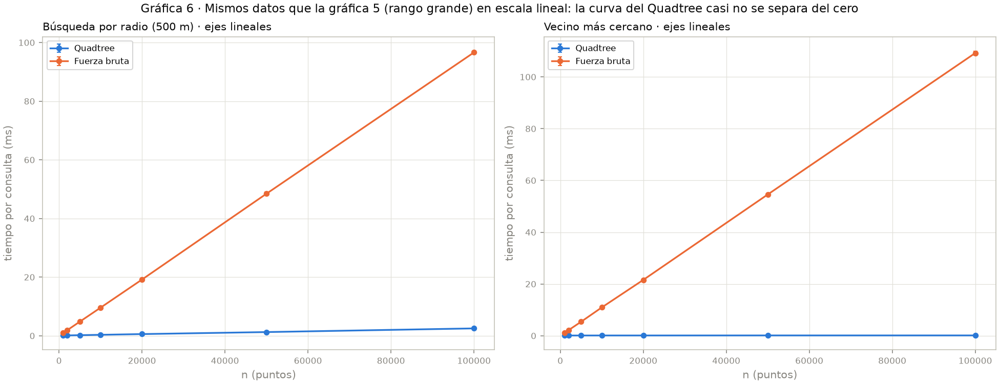

Con ejes lineales la curva del Quadtree queda pegada al cero mientras la fuerza bruta llega a 97–109 ms por
consulta: es la misma diferencia de dos órdenes de magnitud que en la gráfica 5 se ve como una distancia
constante.

### Gráfica 7 — Capacidad por nodo
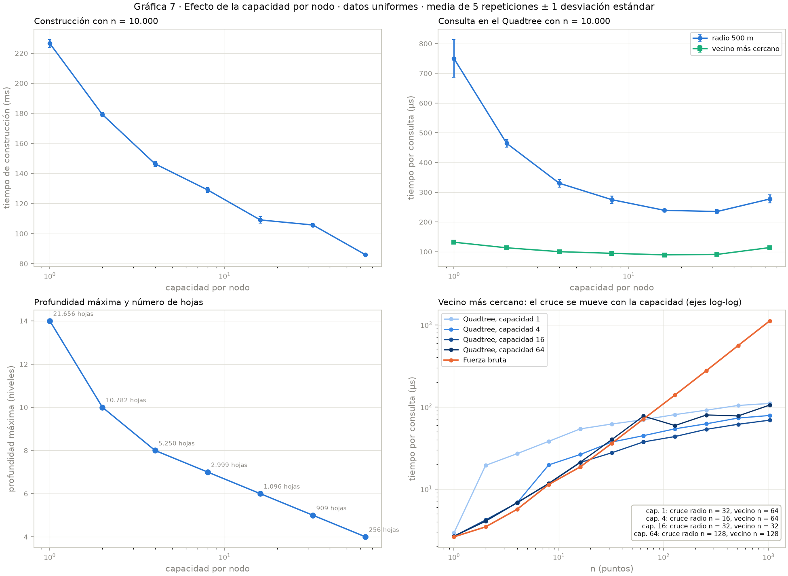

**Capacidad** = cuántos puntos guarda una hoja antes de dividirse.

| capacidad | construir (ms) | radio (µs) | vecino (µs) | profundidad | hojas | cruce radio | cruce vecino |
|---:|---:|---:|---:|---:|---:|---:|---:|
| 1 | 226,5 | 749,6 | 132,0 | 14 | 21.656 | 32 | 64 |
| 4 | 146,4 | 330,4 | 100,3 | 8 | 5.250 | 16 | 64 |
| 16 | 109,1 | 239,2 | 89,5 | 6 | 1.096 | 32 | 32 |
| 64 | 85,9 | 277,3 | 113,9 | 4 | 256 | 128 | 128 |

Subir la capacidad abarata la construcción (menos divisiones). La consulta tiene un punto óptimo en
**16–32**: con capacidad 1 hay 14 niveles y muchas llamadas recursivas; con 64 las hojas son tan grandes que
se miden muchos puntos de más. Con capacidad 64 el cruce no puede ocurrir antes de n = 65, porque hasta ahí
el árbol es una sola hoja.

### Gráfica 8 — Uniforme vs agrupado
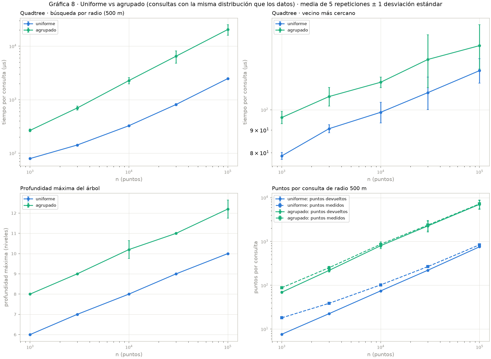

| n = 10.000 | Uniforme | Agrupado | Razón |
|---|---:|---:|---:|
| Profundidad máxima | 8 | 10,2 | +2 niveles |
| Puntos devueltos por consulta | 74,6 | 801,0 | 10,7× |
| Tiempo de radio | 326 µs | 2.279 µs | 7,0× |
| Tiempo por punto devuelto | 4,4 µs | 2,8 µs | más barato |
| Tiempo de vecino | 98,7 µs | 115,4 µs | +17 % |

Separando las dos causas (como pidió el profesor): **(a)** la profundidad sí crece, pero su efecto se ve en
el vecino, que siempre devuelve un punto, y es solo +17 %; **(b)** la búsqueda por radio es 7× más lenta
porque **devuelve 10,7× más puntos**. No es que el árbol se haya degenerado.

### Gráfica 9 — Radio variable con n fijo
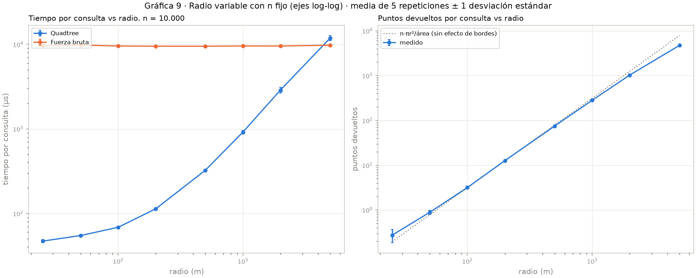

La fuerza bruta es constante (~9,6 ms): siempre mide los 10.000 puntos. El árbol crece con el radio porque
devuelve más puntos. Con **5.000 m la fuerza bruta gana** (0,8×): el círculo cubre casi medio mapa y la poda
casi no descarta nada. El árbol conviene cuando la consulta es **selectiva**. Los puntos devueltos siguen
n·πr²/área hasta ~1.000 m; con radios mayores el círculo se sale del mapa y devuelve menos.

### Gráfica 10 — Tres dimensiones
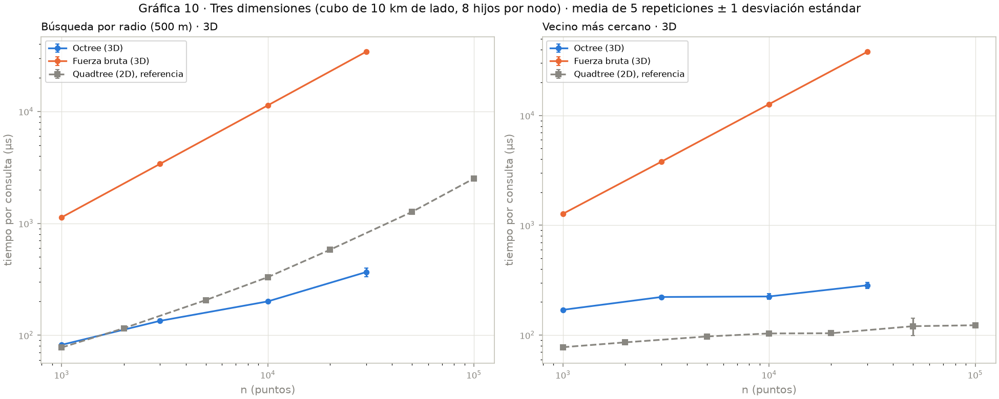

El mismo código con K = 3 (octree, cubo de 10 km). Con n = 30.000 el octree es **93×** más rápido en radio y
**134×** en vecino. El vecino en 3D es más lento que en 2D (225 vs 103 µs con n = 10.000): hay 8 hijos que
ordenar y la esfera toca más cajas (la "maldición de la dimensionalidad" de [2]). El radio en 3D es más
rápido porque una esfera de 500 m ocupa una fracción mucho menor del cubo y devuelve menos puntos.

### Gráfica 11 — Amortización de la construcción
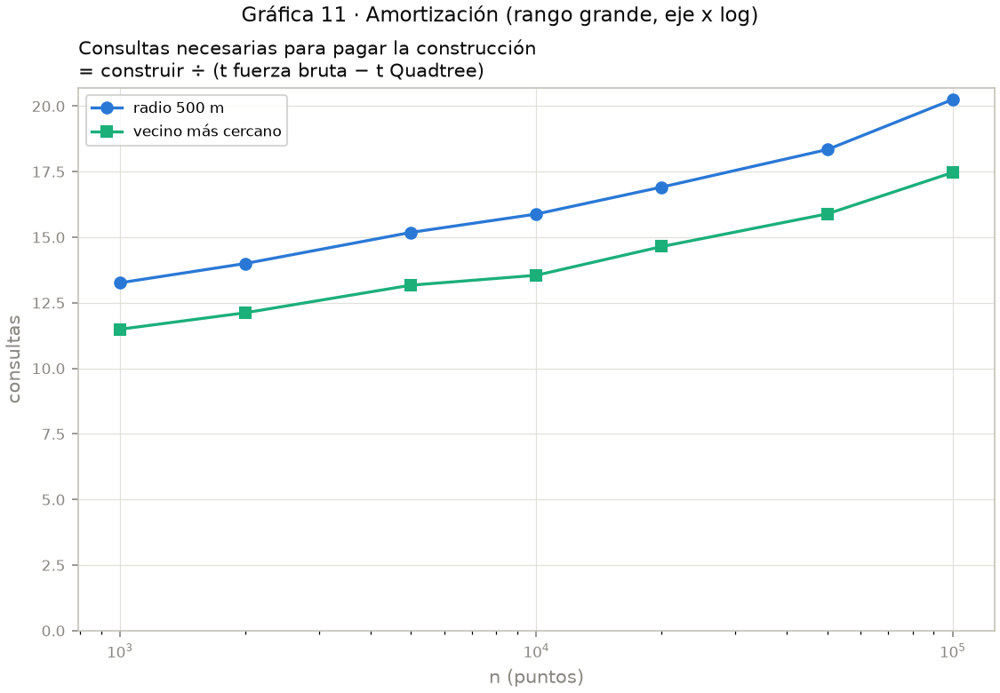

Consultas necesarias = construir ÷ (t fuerza bruta − t Quadtree): entre **12 y 20**, y crece despacio con n
(construir es n log n y lo ahorrado por consulta es ~n).

---

## 11. Respuesta: ¿desde qué tamaño el Quadtree es más rápido que la fuerza bruta?

| | Búsqueda por radio (500 m) | Vecino más cercano |
|---|---|---|
| **Solo consulta** (árbol ya construido) | desde **n = 16** (zona 16–32) | desde **n = 64** (zona 32–64) |
| **Construcción + consulta** | nunca con 1 consulta; desde ~13–20 consultas | nunca con 1 consulta; desde ~12–18 consultas |
| Con n = 10.000 | 29× más rápido; construcción pagada en ~16 consultas | 106× más rápido; pagada en ~14 consultas |

Como los puntos de entrega son **estáticos**, el árbol se construye una vez y se reutiliza para miles de
consultas: para este problema el Quadtree conviene ampliamente.


## 12. Limitaciones (lo que **no** se puede concluir)

* Las mediciones son de **un solo equipo** y en **Python**; en C++ o Java los tiempos absolutos y el cruce
  cambian. Las pendientes y proporciones deberían mantenerse.
* Los datos son **generados**, no un mapa real de Medellín; los agrupados simulan zonas densas con 5 núcleos.
* El árbol es **estático**: no implementé borrar ni mover puntos (el enunciado dice que los datos no cambian).
* La capacidad 4 no es la óptima en mi equipo (16–32 lo fue); la mantuve porque es la de la fuente.
* El 3D se midió hasta n = 30.000; no medí dimensiones altas, donde la poda deja de servir.
* Cerca del cruce las diferencias (10–20 %) son del orden del ruido: el cruce es una zona, no un número.

## 13. Dudas que tuve y cómo las resolví

El registro completo, con los errores reales de la terminal, está en [`mis_dudas.md`](mis_dudas.md). Las principales:

1. **Creía que construir el árbol costaba lo mismo que buscar.** Construir son n bajadas (≈ n log n); buscar
   es una. Lo confirmé en la gráfica 4.
2. **Creía que la distancia mínima a la caja era la distancia al borde.** Si la consulta está dentro, la
   distancia mínima es 0; con la distancia al borde se perderían puntos. Lo probé con mi clase `Caja`.


## 14. Conclusiones

1. **Para este problema el Quadtree conviene ampliamente:** con 10.000 puntos responde 29–106 veces más rápido
   y la construcción se paga con unas 15 consultas.
2. **El cruce es bajo (n ≈ 16–64) y depende de la capacidad:** hasta n = capacidad el árbol es una sola hoja.
3. **Construir y buscar son cosas distintas:** construir ≈ n log n, buscar el vecino ≈ log n.
4. **La búsqueda por radio está limitada por el tamaño de la respuesta**, no por el árbol.
5. **Los datos agrupados hacen el árbol más profundo, pero el costo principal es devolver más puntos.**


## 15. Uso de inteligencia artificial

Ver [`CODIGO_DE_HONOR.md`](CODIGO_DE_HONOR.md).